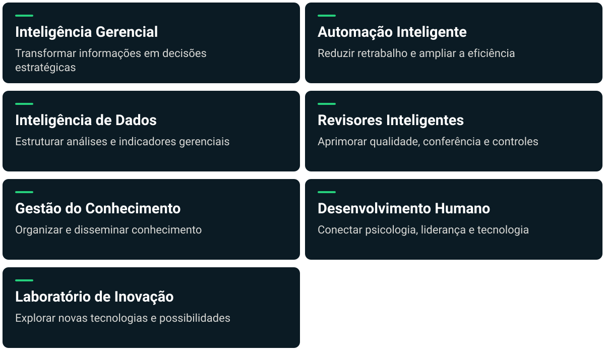

---

---

![Da rotina manual ao processo em lote. Observar. Mapeio lançamentos manuais e pontos de retrabalho. Questionar. Identifico a origem das divergências e exceções. Estruturar. Traduzo regras da folha em critérios de conferência. Construir. Crio lotes de importação e revisores de folha. Validar. Concilio totais e testo cenários e exceções. Evoluir. Acompanho tempo, erros e retrabalho a cada ciclo. Ferramentas. Desenvolvimento: Python, Streamlit, Cursor, GitHub. Dados e BI: SQL, Power BI. Inteligência Artificial: Claude, ChatGPT, Google Gemini. Automação e Fluxos: Pipefy, Microsoft Power Automate. Gestão e Colaboração: Trello, Microsoft Planner, Microsoft Viva Engage, Miro.](https://raw.githubusercontent.com/renata-tinoco/renata-tinoco/17a9334c2686b3eb4aad1a3b01dffc47b37ff6e6/visual-pessoal/metodologia.svg)

---

---

---

---

*Conhecimento que transforma.*

*Estratégia que direciona.*

*Inovação que gera resultados.*

**Renata Tinoco**

