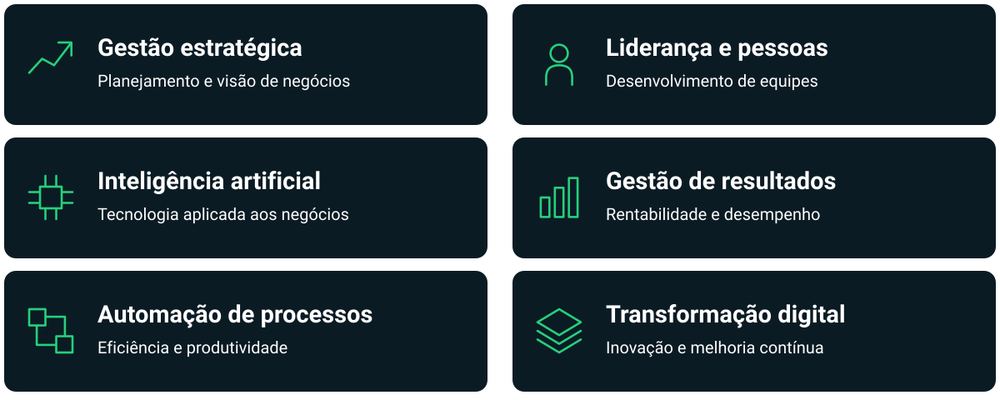
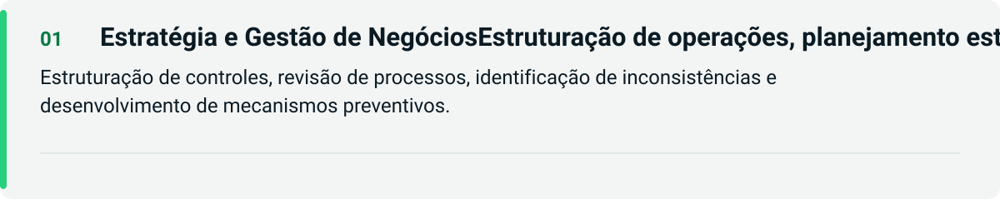
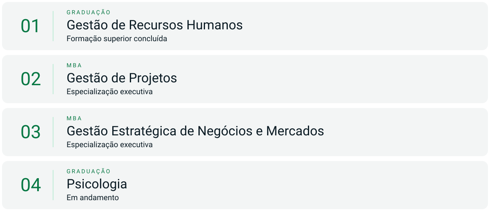
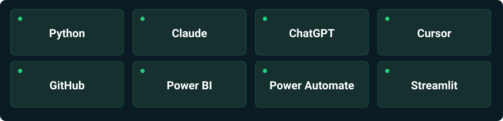
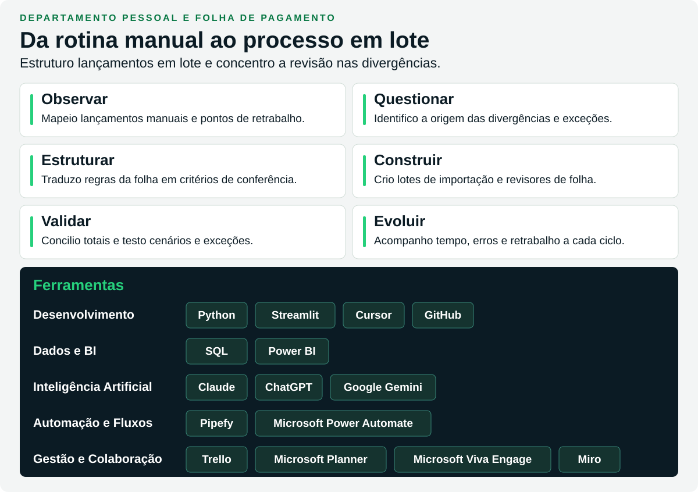
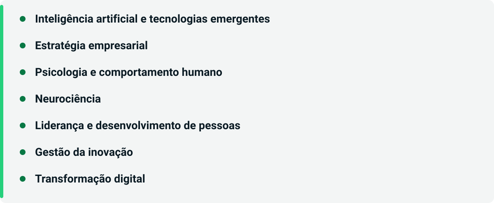

---

---

Gestão de projetos, planejamento operacional, gestão de riscos e conformidade, inteligência de dados, integração de tecnologias e digitalização de operações.

---

Consultar conteúdo em texto

### Estratégia e Gestão de Negócios

Estruturação de operações, planejamento estratégico, análise de desempenho, gestão de recursos e identificação de oportunidades de crescimento e melhoria de resultados.

### Liderança e Desenvolvimento Humano

Desenvolvimento de equipes, gestão de desempenho, construção de ambientes colaborativos e incentivo à autonomia, ao conhecimento e à inovação.

### Inteligência Artificial e Transformação Digital

Aplicação de tecnologias emergentes na resolução de desafios empresariais, desenvolvimento de ferramentas inteligentes e automação de atividades operacionais.

### Inteligência Financeira e Operacional

Análise de rentabilidade, capacidade produtiva, eficiência operacional, indicadores gerenciais e identificação de oportunidades financeiras.

### Gestão de Riscos e Conformidade

Estruturação de controles, revisão de processos, identificação de inconsistências e desenvolvimento de mecanismos preventivos.

---

Minha formação multidisciplinar integra gestão, estratégia empresarial e comportamento humano, ampliando minha compreensão sobre liderança, desenvolvimento de pessoas e tomada de decisão.

---

Consultar conteúdo em texto

Utilizo ferramentas de inteligência artificial, automação, análise de dados e desenvolvimento assistido para transformar conhecimento técnico e necessidades empresariais em soluções aplicáveis.

Meu foco não está apenas na utilização da tecnologia, mas na identificação de onde ela pode gerar valor para os negócios.

---

Consultar conteúdo em texto

**OBSERVAR → QUESTIONAR → ESTRUTURAR → CONSTRUIR → VALIDAR → EVOLUIR**

| Etapa | Propósito |
| :--- | :--- |
| Observar | Compreender o cenário e identificar necessidades reais |
| Questionar | Investigar processos e suas possibilidades de melhoria |
| Estruturar | Organizar requisitos, objetivos e estratégias |
| Construir | Transformar conhecimento em soluções |
| Validar | Avaliar resultados, consistência e aplicabilidade |
| Evoluir | Aprimorar continuamente a solução |

---

Consultar conteúdo em texto

Este espaço é dedicado à apresentação de projetos autorais, estudos, experimentos tecnológicos e soluções demonstrativas aplicadas aos negócios.

| Linha de desenvolvimento | Objetivo |
| :--- | :--- |
| Inteligência Gerencial | Transformar informações em decisões estratégicas |
| Automação Inteligente | Reduzir retrabalho e ampliar a eficiência |
| Inteligência de Dados | Estruturar análises e indicadores gerenciais |
| Revisores Inteligentes | Aprimorar qualidade, conferência e controles |
| Gestão do Conhecimento | Organizar e disseminar conhecimento |
| Desenvolvimento Humano | Conectar psicologia, liderança e tecnologia |
| Laboratório de Inovação | Explorar novas tecnologias e possibilidades |

Os projetos pessoais e demonstrativos apresentados neste ambiente respeitam os princípios de confidencialidade, propriedade intelectual e proteção de dados.

---

Consultar conteúdo em texto

- Inteligência artificial e tecnologias emergentes
- Estratégia empresarial
- Psicologia e comportamento humano
- Neurociência
- Liderança e desenvolvimento de pessoas
- Gestão da inovação
- Transformação digital

Acredito que o conhecimento não deve permanecer isolado. É na integração entre diferentes áreas que encontramos novas perspectivas e possibilidades de transformação.

---

Consultar conteúdo em texto

Minha fé me direciona, o conhecimento me transforma e a curiosidade me mantém em movimento.

Acredito na liderança que desenvolve pessoas, na estratégia que constrói possibilidades e na inovação que gera valor.

Mais do que acompanhar transformações, busco participar da sua construção.

---

---

*Conhecimento que transforma.*

*Estratégia que direciona.*

*Inovação que gera resultados.*

**Renata Tinoco**

