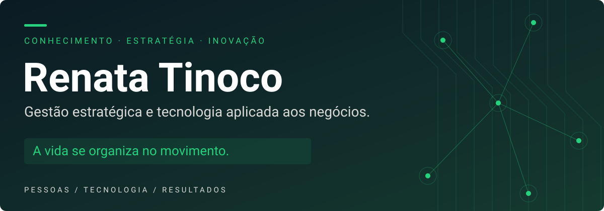
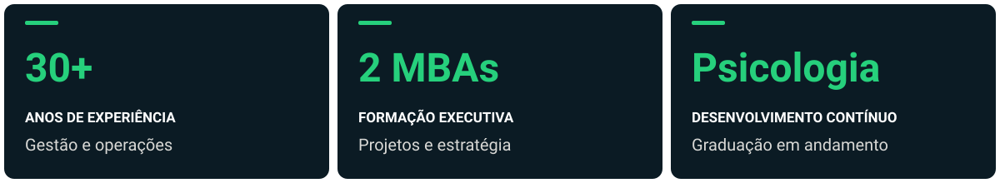
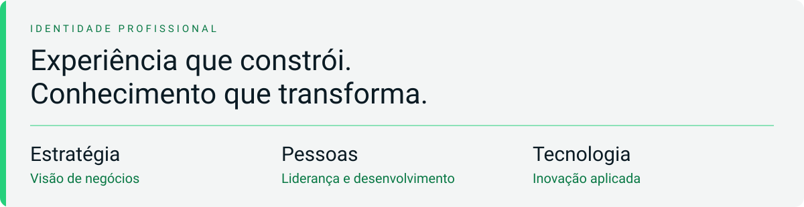
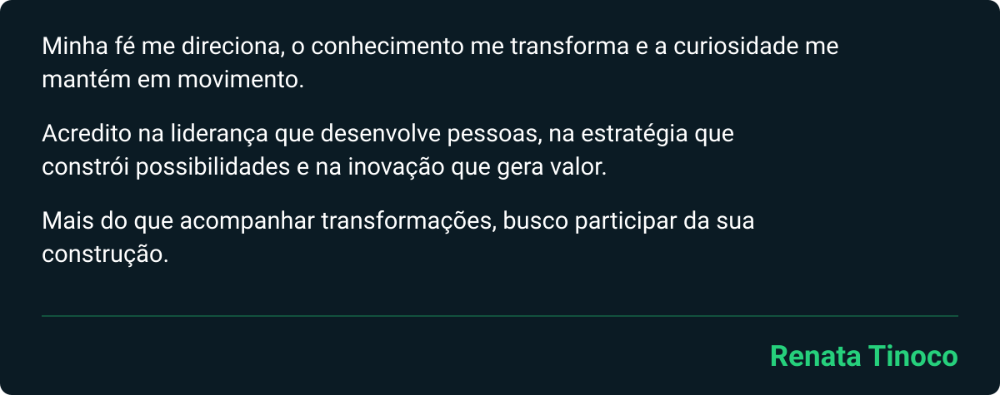

---

---

Aplico minha metodologia de inovação para entender a operação, estruturar melhorias e acompanhar os resultados.

1. **Observar** — Mapear o processo atual, ouvir quem o executa e identificar gargalos, riscos e retrabalho.
2. **Questionar** — Investigar as causas e avaliar quais etapas podem ser simplificadas ou automatizadas.
3. **Estruturar** — Definir prioridades, responsabilidades, regras de negócio e critérios de sucesso.
4. **Construir** — Desenvolver um protótipo, fluxo de trabalho ou painel conforme a necessidade.
5. **Validar** — Testar com quem usa a solução e avaliar indicadores como tempo, erros e retrabalho.
6. **Evoluir** — Incorporar o retorno da equipe, documentar as mudanças e acompanhar os resultados.

**Ferramentas**

Python · SQL · Streamlit · Cursor · GitHub  
Claude · ChatGPT · Google Gemini  
Pipefy · Trello · Microsoft Planner · Microsoft Power Automate · Power BI · Microsoft Viva Engage

---

Consultar conteúdo em texto

Este espaço é dedicado à apresentação de projetos autorais, estudos, experimentos tecnológicos e soluções demonstrativas aplicadas aos negócios.

| Linha de desenvolvimento | Objetivo |
| :--- | :--- |
| Inteligência Gerencial | Transformar informações em decisões estratégicas |
| Automação Inteligente | Reduzir retrabalho e ampliar a eficiência |
| Inteligência de Dados | Estruturar análises e indicadores gerenciais |
| Revisores Inteligentes | Aprimorar qualidade, conferência e controles |
| Gestão do Conhecimento | Organizar e disseminar conhecimento |
| Desenvolvimento Humano | Conectar psicologia, liderança e tecnologia |
| Laboratório de Inovação | Explorar novas tecnologias e possibilidades |

Os projetos pessoais e demonstrativos apresentados neste ambiente respeitam os princípios de confidencialidade, propriedade intelectual e proteção de dados.

---

Consultar conteúdo em texto

- Inteligência artificial e tecnologias emergentes
- Estratégia empresarial
- Psicologia e comportamento humano
- Neurociência
- Liderança e desenvolvimento de pessoas
- Gestão da inovação
- Transformação digital

Acredito que o conhecimento não deve permanecer isolado. É na integração entre diferentes áreas que encontramos novas perspectivas e possibilidades de transformação.

---

Consultar conteúdo em texto

Minha fé me direciona, o conhecimento me transforma e a curiosidade me mantém em movimento.

Acredito na liderança que desenvolve pessoas, na estratégia que constrói possibilidades e na inovação que gera valor.

Mais do que acompanhar transformações, busco participar da sua construção.

---

---

*Conhecimento que transforma.*

*Estratégia que direciona.*

*Inovação que gera resultados.*

**Renata Tinoco**

